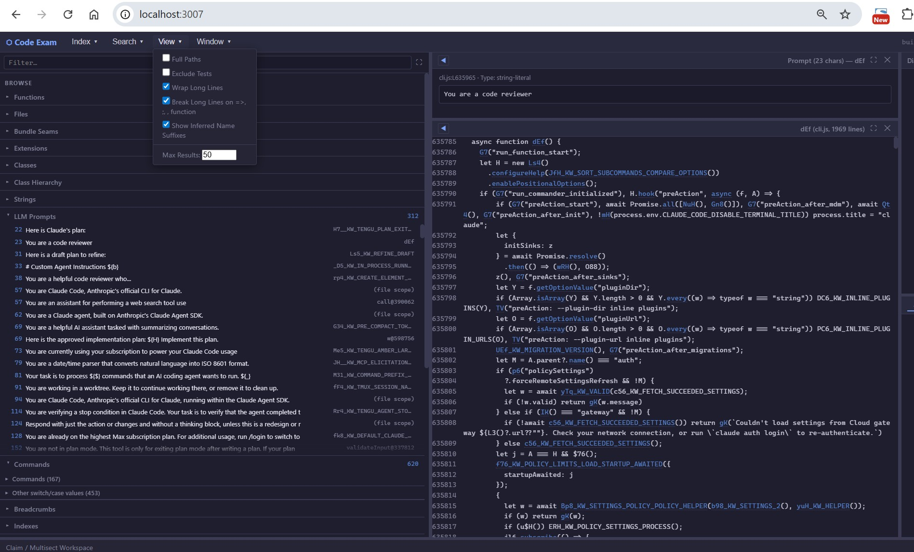

# CodeExam

CodeExam, as its name implies, is a tool for **examining code** — primarily
source code, and with a growing emphasis on **quasi-source** (i.e., recovering
indexable structure from artifacts that weren't shipped as source, such as minified
bundles and binary executable files).

Use CodeExam to first build an index over a codebase, then browse, search,
and cross-reference (callers, callees, call trees, file/folder coupling) at
scale — across **C, C++, Java, JavaScript, TypeScript, Python, C#, Go, Rust,
PHP, Ruby, Kotlin, Swift, Scala, and Objective-C** (tree-sitter), with
regex-level support for a half-dozen more (e.g. Lean, Lua, Perl); what each
language gets from each feature
is on [`CODEEXAM_PROGRAMMING_LANGUAGES.md`](docs/CODEEXAM_PROGRAMMING_LANGUAGES.md).
If you've used a code-comprehension tool
like SciTools Understand, the basic browse and cross-reference features will
feel familiar. CodeExam goes beyond standard code navigation in important
ways, briefly described below and detailed in the individual doc pages linked
below.

CodeExam represents the principal author's **several decades of experience
as a source-code examiner in litigation, and in reverse-engineering
commercial software**. Many of its features grew out of tools written over
the years to index large source trees, to search those indexes in ways
off-the-shelf tools don't, and to extract and summarize information scattered
across a codebase — needs that recur on every examination and that
general-purpose editors and IDEs handle poorly. It was built initially for
source-code examination in patent and trade-secret litigation, but most of
what it does is general-purpose **code comprehension**, useful to anyone
facing a large, unfamiliar codebase they didn't write. Rather than code
maintenance or modification, CodeExam is generally for **scrutinizing code
as-is** — one alternate name for the product is **Scrutable**™.

The engine is **deterministic**: the same index and the same command produce
the same answer, with no AI model in the basic loop. An important but
**optional** set of **AI-based features** can summarize code, answer
questions, and draft analyses, but they only ever touch *output*, never the
index or the core results. They can run against a cloud model (Claude,
ChatGPT, or Gemini) or, for code that must not leave a protected machine, a
**local GGUF model, fully air-gapped**.

There are four ways to drive that one engine and one on-disk index format: a
**CLI**, its **interactive REPL** (read/eval/print loop), a **GUI**
(displayed in your default browser, but without internet; served on localhost
only), and an **MCP server** for AI clients. Build the index once; query it
from any of these four interfaces.

**CodeExam and AI:** CodeExam relates to AI in three distinct ways: (a) AI (primarily Claude Code)
was used to *build* CodeExam; (b) users can *optionally* use AI during an
examination; (c) CodeExam *detects* AI and ML (machine learning) in target code — which,
interestingly, requires no AI at run time: the AI skill and knowledge are
baked into mechanical detectors.



*Prompt catalog — LLM prompts recovered from the minified `cli.js` bundled inside `claude.exe`.*

## Seven key features

These are what sets CodeExam apart from other code-reading tools. The next
section, "What CodeExam is good at," lists the examiner's tasks, each pointing
at the feature that serves it.

1. **AI-assisted examination.** An optional set of AI-based features — using a
   cloud model (Claude, ChatGPT, or Gemini), or a local GGUF model on your
   own GPU — together with CodeExam's tools (the same table its MCP server registers), to summarize code, answer
   questions (in the GUI's Chat, or with `--ask-ai` from the command line), and
   draft analyses. AI-assisted examination may already be
   familiar (e.g. GitHub Copilot); CodeExam's emphasis is on running it over
   its own deterministic index, and on the local option.
   → [`AI_ASSISTED_CODE_EXAM.md`](docs/AI_ASSISTED_CODE_EXAM.md),
   [`LOCAL_LLM.md`](docs/LOCAL_LLM.md)

2. **Air-gapped operation.** CodeExam can run with all internet/cloud access
   blocked — for code that must not leave a protected machine. Even with all
   internet/cloud access blocked, you still have the option of using
   CodeExam's AI features by pointing it at a local AI (GGUF) model. Though
   optional and only one part of CodeExam, and while most users won't need
   it, and while local-LLM code analysis is a work in progress, nonetheless
   "local first" is a key underlying premise: we see local
   models and more capable GPU machines becoming steadily more important.
   → [`AIR_GAPPED.md`](docs/AIR_GAPPED.md), [`LOCAL_LLM.md`](docs/LOCAL_LLM.md)

3. **Uncovering what a codebase is about.** CodeExam works to extract a
   codebase's "vocabulary" and key concepts, its "breadcrumbs" (telemetry
   markers in code), and referenced-resources (data files, URLs, environment variables, etc.) — and presents initial questions to ask and
   good first places to look, via the Overview and (optional) Overview by AI
   features. The `--toc` and `--mechanisms` commands group every function in
   the index into named "mechanisms" — a table of contents for the codebase —
   with a one-sentence description of each when a model is run over them.
   → [`UNCOVER_KEY_CODE.md`](docs/UNCOVER_KEY_CODE.md),
   [`CODEEXAM_MECHANISMS.md`](docs/CODEEXAM_MECHANISMS.md)

4. **Quasi-source.** A surprising amount of indexable structure can be
   recovered from artifacts never shipped as source — minified/bundled JS,
   binaries (strings + demangled C++ symbols), JavaScript embedded inside
   native executables — then searched and cross-referenced with the same
   machinery as real source. → [`QUASI_SOURCE.md`](docs/QUASI_SOURCE.md)

5. **Detecting AI and ML (machine learning) and infrastructure in target code.** A detector suite
   surfaces inferred AI/ML pipelines, the models a codebase defines and
   uses, LLM calls, tools, agents/chains, embeddings, prompts, and the
   operational stack (e.g. containers).
   → [`DETECTING_AI_ML.md`](docs/DETECTING_AI_ML.md)

6. **Structural (non-textual) code search.** Ways of finding and identifying
   code that don't depend on what the code *says*: structural
   duplicate detection and diff, transform-resilient function fingerprints
   ("funcstrings"), synonym expansion in Multisect search, "searching by counting," and catalogs that
   link commands to their handlers by position in dispatch tables rather
   than by name. → [`STRUCTURAL_SEARCH.md`](docs/STRUCTURAL_SEARCH.md), [`UNCOVER_KEY_CODE.md`](docs/UNCOVER_KEY_CODE.md)

7. **Working between technical prose and code.** Charting a patent claim (or a
   passage of a technical specification) against a codebase one element at a
   time, with the code cited for each element; drafting "pseudo-claims" from
   code — claim-shaped descriptions of what each mechanism does; and
   `ce --hof`, a self-test that drafts a claim from each group of an index's
   functions and asks the claim features to find their way back to the code.
   → [`CODEEXAM_PATENT_CLAIMS.md`](docs/CODEEXAM_PATENT_CLAIMS.md),
   [`CODEEXAM_CLAIM_CHARTS.md`](docs/CODEEXAM_CLAIM_CHARTS.md),
   [`CODEEXAM_PSEUDO_CLAIMS.md`](docs/CODEEXAM_PSEUDO_CLAIMS.md)

## What CodeExam is good at

- **Orienting fast in unfamiliar code** — Vocabulary and Overview help tell you
  what a codebase is about and where to look first, before you read a line.
  → [`UNCOVER_KEY_CODE.md`](docs/UNCOVER_KEY_CODE.md)
- **Helping to prove an absence** — corpus-wide *negative* search: helping
  show something is *not* present anywhere in the index, not just that it's
  missing from the file you happened to open. (Caveat: absence from the *index*
  is only as complete as the index — `--build-index` warns when file types
  weren't included, `ce --help extensions` manages that, and
  `--referenced-resources` finds objects the code references but doesn't contain.)
  → [`CODEEXAM_SEARCHING.md`](docs/CODEEXAM_SEARCHING.md). See "Some current
  limits" below on using --all-results before concluding absence.
- **Examining what wasn't shipped as source** — quasi-source recovers
  structure from minified bundles and binaries.
  → [`QUASI_SOURCE.md`](docs/QUASI_SOURCE.md)
- **Seeing what the code points to but doesn't contain** —
  `--referenced-resources` surfaces the external surface: URLs and hosts, env
  vars, file paths, external commands, cloud config, and model IDs —
  including files the code references but that aren't in the index (config,
  data, keys, templates), with how often each is referenced.
  → [`CODEEXAM_BROWSING.md`](docs/CODEEXAM_BROWSING.md)
- **Mapping what the code depends on** — `--bom` classifies imports,
  include and run-time load as internal, standard-library, third-party or
  vendored, each with its evidence (manifests, lockfiles, build files), and
  `--copyrights` adds whose notices are on the files; what an SBOM is and is
  not, and where such a list can still miss something.
  → [`CODEEXAM_MAPPING_DEPENDENCIES.md`](docs/CODEEXAM_MAPPING_DEPENDENCIES.md)
- **Working on technical prose, not just code** — charting **text (such as
  patent claims, and portions of technical specifications)** against a
  codebase, and describing what the code does in claim-shaped language: key
  feature 7 above. For a worked example, the pseudo-claims feature run on
  CodeExam's own source — ten claims across nine features quoted as drafted,
  each beside the rubric claims the author wrote by hand for that feature →
  [`CODEEXAM_SELF_PORTRAIT.md`](docs/CODEEXAM_SELF_PORTRAIT.md)
- **Multisect search** — narrowing a multi-term search to the smallest scope
  in which all the terms co-occur, from file or class, to function, to the specific
  lines. → [`CODEEXAM_SEARCHING.md`](docs/CODEEXAM_SEARCHING.md)
- **Helping map the client/server boundary** — `--client-server` finds
  declared server routes and the client calls that consume them, reconciled
  by URL path, and flags client calls with **no matching server route** — the
  "missing server code" signal (e.g. a production that ships the client but
  withholds the server). It's a heuristic pass over the HTTP surface, currently
  strongest on common JS/Express-style shapes, not a full routing-graph
  analysis. → [`CODEEXAM_BROWSING.md`](docs/CODEEXAM_BROWSING.md)

## Quick start

CodeExam needs **[Node.js 18+](https://nodejs.org)** and a one-time
`npm install` from the project root:

```bash
npm install
```

**First time?** A fresh download bundles a small demo index, so a bare `ce`
shows a short welcome and `ce --gui` opens the GUI on the demo — no build
needed to look around. See
[`GETTING_STARTED.md`](docs/GETTING_STARTED.md), which also covers the REPL, 
the MCP server, requirements, and network-exposure cautions. 

Build an index over a codebase — a directory, a zip/tar archive, a single
file, or an `@filelist` — and give the index a name with `--index-path` or `--ndx`:

```bash
# Build an index named .mycode over a codebase
node src/index.js --build-index /path/to/codebase --index-path .mycode
```

Then query it — every command reads the index you name with `--index-path` or `--ndx`:

```bash
# What is this codebase about? Its top domain-specific terms (TF-IDF)
node src/index.js --index-path .mycode --vocabulary 25

# One-shot orientation: size, languages, structure, entry points
node src/index.js --ndx .mycode --overview

# List functions, largest first
node src/index.js --ndx .mycode --functions --sort size

# List LLM prompts found in the code, with the associated code
node src/index.js --ndx .mycode --prompt-catalog

# Run several commands on one index in a single invocation (ce shim, below)
ce --ndx .sr_gh --models --command-catalog

# Add -v / --verbose for more detail on many commands
ce --ndx .sr_gh --models -v
```

The repo ships shims — **`ce`** (POSIX) / **`ce.bat`** (Windows) — so `ce
--index-path .mycode --overview` is shorthand for `node src/index.js
--index-path .mycode --overview`.

To open the same index in the **GUI**, add `--gui`:

```bash
ce --gui --index-path .mycode
```

It prints a localhost URL to open in your browser (e.g.
`http://127.0.0.1:3000/`). Stop it with Ctrl-C in that terminal; only closing the
browser tab leaves the server running (and the current index still loaded in memory).

**Some current limits.** Output from many commands is capped by default, to
simplify output especially in the GUI, so absence in a result can mean "past
the limit," not "not there" — raise `--max-results <N>` or `--all-results` when 
it matters (#137), and before concluding absence. 
Language coverage is deep for the tree-sitter languages and shallower
(regex-level) for the rest, so parse gaps are possible — C++ class
recognition in particular is currently incomplete. And CodeExam works from an index
*snapshot*: it reflects the code as it stood when the index was built, so
rebuild the index to pick up later changes. For a more thorough list, see
[`CODEEXAM_KNOWN_LIMITATIONS.md`](docs/CODEEXAM_KNOWN_LIMITATIONS.md) and the
[open issues](https://github.com/aschulman42-cell/code-exam/issues?q=is%3Aissue+state%3Aopen).

## Documentation

| Doc | What's in it |
|---|---|
| [`GETTING_STARTED.md`](docs/GETTING_STARTED.md) | Install, requirements, and the ways to run CodeExam (CLI, REPL, GUI, MCP) |
| [`CODEEXAM_CLI.md`](docs/CODEEXAM_CLI.md) | CLI overview (see also [`docs/cli.md`](docs/cli.md), the per-flag reference) |
| [`CODEEXAM_GUI.md`](docs/CODEEXAM_GUI.md) | GUI layout — panes, accordions, Workspace |
| [`CODEEXAM_MCP.md`](docs/CODEEXAM_MCP.md) | The MCP tool surface as an LLM client sees it |
| [`CODEEXAM_NOTATION.md`](docs/CODEEXAM_NOTATION.md) | Symbols & notation shared by the CLI and GUI |
| [`CODEEXAM_JARGON.md`](docs/CODEEXAM_JARGON.md) | The words the claim, pseudo-claim and mechanism pages use — mechanism, grouper, candidate, drafter, locator, anchor, sidecar, HOF, ladder — each defined once, with where you meet it and which pages lean on it |
| [`CODEEXAM_KEY_FEATURES.md`](docs/CODEEXAM_KEY_FEATURES.md) | Browse and search, catalogs — the overview |
| [`TOUR.md`](docs/TOUR.md) | A short tour of the bundled demo index: the GUI's AI/ML accordions, then four commands to try on it |
| [`CODEEXAM_SEARCHING.md`](docs/CODEEXAM_SEARCHING.md) | Literal / fast / regex search and multisect |
| [`CODEEXAM_BROWSING.md`](docs/CODEEXAM_BROWSING.md) | Structural lists, cross-reference, and code-surfacing metrics |
| [`CODEEXAM_MAPPING_DEPENDENCIES.md`](docs/CODEEXAM_MAPPING_DEPENDENCIES.md) | Imports, the bill of materials, and dependencies: each dependency command (and the GUI's Imports accordion) in one table — what it answers, what it reads, what it does not read — and what is not done |
| [`UNCOVER_KEY_CODE.md`](docs/UNCOVER_KEY_CODE.md) | Vocabulary, breadcrumbs, Overview / Overview by AI |
| [`MEASURING_IMPORTANCE.md`](docs/MEASURING_IMPORTANCE.md) | How CodeExam estimates "importance" (rareness, TF-IDF, cross-corpus down-weighting, centrality) and uses it to steer and sort |
| [`CODEEXAM_SUMMARIZING.md`](docs/CODEEXAM_SUMMARIZING.md) | Summarizing code: overview, digest, analyze, GUI chat, and the mechanisms and `--toc` table of contents (outline) |
| [`QUASI_SOURCE.md`](docs/QUASI_SOURCE.md) | Binary analysis and bundled-JS extraction |
| [`DETECTING_AI_ML.md`](docs/DETECTING_AI_ML.md) | The AI/ML, LLM-app, and infrastructure detector suite |
| [`STRUCTURAL_SEARCH.md`](docs/STRUCTURAL_SEARCH.md) | Non-textual search: fingerprints, structural dupes, deobfuscation; and where semantic search stands (`--embed-distance` measures; prose-to-code search is being built on #363) |
| [`CODEEXAM_COMPARING.md`](docs/CODEEXAM_COMPARING.md) | Comparing code: near/structural duplicates, struct-diff, external diff tools (outline) |
| [`AI_ASSISTED_CODE_EXAM.md`](docs/AI_ASSISTED_CODE_EXAM.md) | Optional LLM assistance (`--analyze`, claim search, input masking) |
| [`CODEEXAM_PATENT_CLAIMS.md`](docs/CODEEXAM_PATENT_CLAIMS.md) | Searching and charting patent claims against a codebase |
| [`CODEEXAM_CLAIM_CHARTS.md`](docs/CODEEXAM_CLAIM_CHARTS.md) | Claim charts, a patent claim against source code one element at a time: how the claim commands fit together, what CodeExam can do today, a summary of what works/doesn't, the air-gapped goal and the plan |
| [`CODEEXAM_CLAIM_CHARTS_TESTS.md`](docs/CODEEXAM_CLAIM_CHARTS_TESTS.md) | The tests behind claim charts: the public filings whose charts cite open-source code, the agreement runs on them, the self-test and the Gemma 4 (local LLM) results |
| [`CODEEXAM_PSEUDO_CLAIMS.md`](docs/CODEEXAM_PSEUDO_CLAIMS.md) | Drafting illustrative "pseudo-claims" from code: the mechanisms as candidates, anchors, `--filter`, the optional descriptions and `--embed-distance`, and `ce --hof`, the self-test |
| [`CODEEXAM_PSEUDO_CLAIMS_TESTS.md`](docs/CODEEXAM_PSEUDO_CLAIMS_TESTS.md) | The tests behind pseudo-claims: the HOF self-test, the real-world yardstick, the rubric scores |
| [`CODEEXAM_MECHANISMS.md`](docs/CODEEXAM_MECHANISMS.md) | Mechanisms: how CodeExam groups any codebase's functions, how to read a label, the optional descriptions, and what the groups are used for: pseudo-claims and the --toc (Table of Contents) feature |
| [`CODEEXAM_SELF_PORTRAIT.md`](docs/CODEEXAM_SELF_PORTRAIT.md) | The pseudo-claims feature run on CodeExam's own source: ten claims across nine features, quoted as drafted, each beside the rubric claims the author wrote by hand for that feature |
| [`LOCAL_LLM.md`](docs/LOCAL_LLM.md) | Local GGUF models, e.g. Gemma4, Qwen |
| [`AIR_GAPPED.md`](docs/AIR_GAPPED.md) | Enforced no-cloud operation |
| [`SOURCE_CODE_PROTECTIVE_ORDERS.md`](docs/SOURCE_CODE_PROTECTIVE_ORDERS.md) | Source-code protective orders: the basics, the 2025–2026 AI provisions ("fully containerized"), and where CodeExam fits in |
| [`CODEEXAM_AND_UNDERSTAND.md`](docs/CODEEXAM_AND_UNDERSTAND.md) | CodeExam beside SciTools Understand: where they overlap, the two "Overview" features that share a name, what each does that the other does not, using both in the same source-code exam |
| [`REPRODUCIBILITY.md`](docs/REPRODUCIBILITY.md) | Reproducibility of AI-layer answers; pinning the model side (`--reproducible`) |
| [`CODEEXAM_INDEXES.md`](docs/CODEEXAM_INDEXES.md) | Building and managing indexes; the on-disk format |
| [`CODEEXAM_PROGRAMMING_LANGUAGES.md`](docs/CODEEXAM_PROGRAMMING_LANGUAGES.md) | Which languages get a grammar and which the regex parser, and what each feature reads per language: one table, then the detail for Swift, Kotlin, Rust, Objective-C, Scala and the rest, with the corpora each was measured on |
| [`CODEEXAM_ARCHITECTURE.md`](docs/CODEEXAM_ARCHITECTURE.md) | Engine and module layout; see also the orientation site's five architecture diagrams under [`docs/orientation/architecture`](docs/orientation/architecture) |
| [`CODEEXAM_TESTING.md`](docs/CODEEXAM_TESTING.md) | The test suite |
| [`CODEEXAM_FAQ.md`](docs/CODEEXAM_FAQ.md) | Behaviors in the CLI and GUI likely to surprise a new user, each with a workaround; entries are removed as they are fixed |
| [`CODEEXAM_KNOWN_LIMITATIONS.md`](docs/CODEEXAM_KNOWN_LIMITATIONS.md) | Current gaps and limitations |
| [`CODEEXAM_CODECLAIM.md`](docs/CODEEXAM_CODECLAIM.md) | CodeExam's relation to patent analysis, and possible directions for the CodeClaim product |
| *Working records* | *The lower-case pages are the measurements, ledgers and drafts behind the feature pages above, not feature pages themselves* |
| [`ai-assisted-examination-gotchas.md`](docs/ai-assisted-examination-gotchas.md) | Draft: some ways AI-assisted code examination can go wrong and how to catch them, for experts and the attorneys who rely on them |
| [`real-world-claim-charts.md`](docs/real-world-claim-charts.md), [`claim-chart-agreement.md`](docs/claim-chart-agreement.md), [`claim-chart-drafter-ceiling.md`](docs/claim-chart-drafter-ceiling.md) | The real-world tests: public filings whose charts cite open-source code, whether CodeExam finds the code a litigant charted, and whether the LLM asked to draft the chart can express the party's theory; a party's chart is advocacy, not an answer key |
| [`model-support.md`](docs/model-support.md) | Which local models can be relied on, per LLM-based feature; and the table of where a model touches CodeExam's output (vs. CE output that isn't model-dependent) |
| [`example-indexes.md`](docs/example-indexes.md) | Recipes for trying CodeExam on public code: get the source, build an index, run a few first commands |

## API costs

CodeExam itself has no cost to run — only its **optional** cloud-AI features
do, and only when you use them. Those features call a paid API (Anthropic,
OpenAI, or Google); per request the amounts are small — a whole-codebase AI
Overview typically runs around $0.50, analyzing a single function a few
cents — and CodeExam shows an estimated cost before it spends. Two guards keep
it bounded:

- **`--max-budget-usd`** — a hard spend ceiling on an Overview by AI run (also
  settable via the `CE_OVERVIEW_MAX_BUDGET` environment variable; default $5).
- **`CE_CLAIMS_COST_GUARD`** — an estimated-cost threshold for the
  claim/analyze pipeline: if a run's projected cost exceeds it, CodeExam stops
  and asks before sending anything (raise the value, or pass `--force`, to
  proceed).

Both guards are **per run** — a ceiling on a single Overview by AI, or a pre-flight
estimate on a single claim/analyze run. Neither accumulates spend across separate
`ce` invocations or within a GUI session, so size each run's limit accordingly.

Running a **local GGUF model has no API cost at all** — another argument for
the local path.

## Related: CodeClaim

A patent-focused build, tailored for IP-litigation workflows, is being
developed using the name **CodeClaim**; it shares the CodeExam engine, and
CodeExam itself already carries some claim-analysis machinery. See
[`CODEEXAM_CODECLAIM.md`](docs/CODEEXAM_CODECLAIM.md).

---

*CodeExam is roughly 90,000 lines of JavaScript (about 135,000 counting the
test suite and dev scripts, the scripts mostly `.mjs`) running under Node.js, nearly all written by
Claude Code in close collaboration with the main author, in several places
building on his earlier tooling. [[placeholder for URLs to ndx/find C++ and
awk code; Opstrings code; term-ranking code; module import/export source/sink
code; cgrep (context-grep with a delimiter); possibly tools from the
Schulman-authored portions of Undocumented DOS, 2nd edition; etc.]] CodeExam and CodeClaim
are developed by Andrew Schulman — see
[CodeExam.ai](https://codeexam.ai) and
[softwarelitigationconsulting.com](https://www.softwarelitigationconsulting.com/).*

*Examples of how different CodeExam features evolved from an initial "vibe"
request to current code will be added later. For now, some early work with
Claude can be seen for the
[Python prototype](https://claude.ai/share/f601d9be-5e3c-4353-a643-2d148bb83a16)
and the
[initial Python-to-Node.js port](https://claude.ai/share/e86c26cf-69d4-454a-94b9-bc9aed7bf523).*

CodeExam's local-LLM features were developed in part using **two** Claude Code (CC)
instances — one on the main development computer, the other on an Asus laptop with an
NVIDIA RTX 5080 GPU — communicating via a "blackboard" built on GitHub issues that the two
instances periodically checked and wrote to, sometimes at great length and sometimes a bit 
incomprehensibly, even to the human ostensible main developer (see e.g. #308, #318, #353, #363).

CodeExam was developed under **Bram** ("Bram runs agents mindfully") by Jon Udell, whose name
is also reflected in the "jontest-CC" handle seen in the issues. For more on Bram, see
[blog.jonudell.net](https://blog.jonudell.net/) and [github.com/judell/bram](https://github.com/judell/bram).

*The CodeExam documentation was initially drafted by Claude Code, with substantial editing
("punch lists") by Schulman.*
