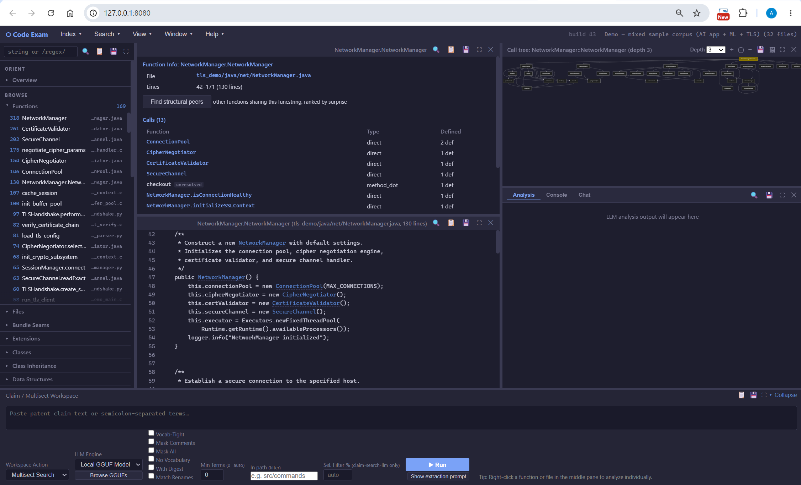
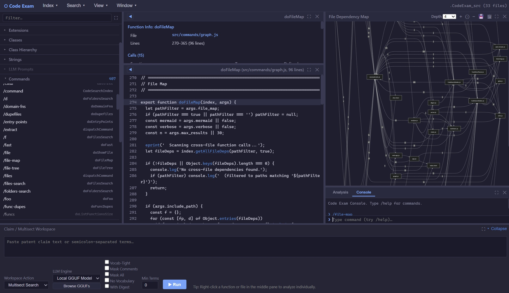

# The CodeExam GUI

`node src/server.js --port 3000` (or just `ce --gui`) opens CodeExam's multi-pane interface in
your browser. It is called the **GUI** rather than a "web UI" on purpose: it binds **127.0.0.1**
only, makes no outbound network calls of its own, and simply happens to render in a local browser —
nothing about it is web-facing. Launch, the loopback-only posture, and the demo index are covered
in [`GETTING_STARTED.md`](GETTING_STARTED.md); this page describes what the interface does.

*The GUI on the bundled demo index: the menu bar on top; left-pane catalogs; the middle output and
source panes; a diagram pane and the tabbed Analysis / Console / Chat pane on the right; and the
Claim / Multisect Workspace across the bottom. (September 2026.)*

## The layout

The GUI is organized into a menu bar and several panes:

- **Menu bar** (top) — the **Index**, **Search**, **View**, **Window**, and **Help** dropdowns,
  with the build number and a summary of the loaded index on the right. The menus open the main
  dialogs and options: **Index** → **Load Index** and **Build Index** (and lists the indexes it
  finds); **Search** → the search dialog and its match options; **View** and **Window** → which
  panes are shown and how they're arranged (including pop-outs, **View → Exclude Tests**, and **View → Max Results**, which caps how many rows a pane returns);
  **Help** → the README and the guided tour. The GGUF-model browser (for choosing a local model)
  is reachable from the Workspace and the menus.
- **Left pane** — a search box plus the catalogs you browse the codebase through (detailed below).
- **Middle column** — two stacked panes. The **upper** pane shows a command's output: search
  results, a function's info and its calls, a digest, or a catalog. The **lower** pane is the
  **source viewer**. Selecting a row in the upper pane typically opens the corresponding source (or
  expands a collapsed/deduped result row) in the lower pane.
- **Right column** — two stacked panes. The **upper** pane draws **diagrams** — call trees and
  file-coupling / relationship views — with a depth control, zoom, and image export. The **lower**
  pane is tabbed: **Analysis** (LLM analysis output), **Console** (the interactive REPL), and
  **Chat** (LLM chat over the tools).
- **The Claim / Multisect Workspace** (bottom, full-width, collapsible) — paste a patent claim or a
  list of semicolon-separated terms, pick a **Workspace Action** (e.g. Multisect Search), set the
  options (mask comments, mask all, vocabulary, digest, minimum terms, a path filter), choose the
  **LLM engine** (a cloud model or a local GGUF), and **Run**. This is the GUI entry point to the
  multisect / claim-search workflow described in [`AI_ASSISTED_CODE_EXAM.md`](AI_ASSISTED_CODE_EXAM.md);
  **Show extraction prompt** prints the prompt without calling a model.

**Common pane controls.** Every pane's header carries the same set of controls: **find in pane**,
**copy to clipboard**, **save to file**, **pop out / enlarge**, and close.

**Right-click** a function or file — in the left pane or the middle pane — for a context menu of
actions on that item: extract, digest, callers, analyze. (The Analyze action uses whichever LLM
engine is currently selected, so what it offers tracks your engine choice.)

**Panes that obscure each other.** A popped-out or enlarged pane can end up on top of another; the
**Window** menu controls which panes are shown and how they're arranged, so use it to surface a
pane hidden behind another. Pane layering is one of the rough edges the redesign below addresses.

The exact pane geometry is deliberately in flux: CodeExam is moving away from a fixed layout toward
a design where many features behave as semi-independent mini-apps — so that, for example, several
instances of a feature can run side by side for comparison, and long-running operations proceed on
their own threads. That redesign, and the open questions behind it, are tracked in
[#38](https://github.com/aschulman42-cell/code-exam/issues/38).

## The left pane: browse, catalogs, and duplicates

The left pane is where you orient yourself in an unfamiliar codebase. Under an **Orientation** heading (**Orient** until 2026-11-25)
sit the lists that say what the code is about: **Overview** (the one-shot "what is this codebase"
summary), **Concepts** (the words the code seems to be about, described below), **Vocabulary**,
**Mechanisms** and **Function texts** (the last three moved here from Browse on 2026-11-24); under
**Browse** sit the structural lists — **Functions**, **Files**, **Classes**, **Class Inheritance**,
**Data Structures**, plus **Bundle Seams** and the extension census. Clicking a row loads it into the
middle panes. **Mechanisms** is the one list the GUI does not compute on each open: it reads the
records `ce --index-path <X> --build-mechanisms`, or the pane's own **Build** button, wrote beside
the index (one per file, class, command or shared name token, every function in at least one,
records overlapping; what a mechanism is and how its label reads: [`CODEEXAM_MECHANISMS.md`](CODEEXAM_MECHANISMS.md)). The list has one row per function set: records that are the same functions
under two labels (a one-class file as `[class] Foo` and `[file] foo.py`) are one row, the other
label after `also` in the muted line and a `×2` beside the counts, so the badge counts rows, not
records (383 on CodeExam's 390 records). Rows that are wholly test code are left out, and the
rows come largest first; the line under the
**Describe** bar says how many test rows were left out and carries links, **show**,
**source order** and **by similarity**, that change each for as long as the page is open (the CLI's `--include-tests`,
`--sort-by path`, which groups the rows by source directory under a muted line with the directory and its row count, and, since 2026-11-25, `--sort-by similarity`, which puts mechanisms whose text is alike next to each other. That order is read from what `--carve clusters` saved in the index and is never built by the GUI; with none saved the list is empty and gives the command to run. **View → Exclude Tests** does not act on this list). A row opens with the
record id (`m4`; first on the main row since 2026-11-24, where it had been on the muted line
beneath), then the model's one-sentence description when `--describe` wrote one and the sentence
names its subject, the label then sitting beneath it; when the sentence opens with This, These or
The functions the headline is `label — sentence`, so the name reads before the pronoun (the route
sends `names_subject`, judged by the one rule the CLI listings apply); otherwise the id is followed
by the label, over the purpose read from the code's own doc text. Under a filter, a row matched on
something it does not show (a member, a file, a purpose a sentence replaced) opens
its muted line with what matched, `holds <member>`, `in <file>` or `purpose "…"`, the CLI
listings' words, so the reason is visible before the row is opened. Beside either sit its
member and file counts and tags (`test`, `vendored`, `giant` for
a record the splitter could not break), and `×N` on a row that stands for N records with the same
functions. Clicking a row puts the mechanism in the upper middle pane (since 2026-11-24; a row had
expanded in place to its members, and only a `×N` row used the pane), as a click on a Vocabulary
or Concepts row does. The pane shows the mechanism in full and without code, what
`--mechanisms -v` prints for it and what the file holds besides: its id and label, its kind, any
other labels for the same functions, the model's description with the model's name, the purpose
read from the code, its tags, what it calls, its size, then its functions as `file@function`
references with their lines, and its files. A click on a reference opens that function's source
in the lower middle pane, so the upper pane keeps the mechanism; a right-click on one gives the
menu a function has elsewhere. Only one mechanism's functions are in view at a time: rows no
longer open side by side in the left pane.
A **Describe** button at the top of the list asks the
Workspace engine for a one-sentence description of each listed row that has none, the same
sentence `--describe` writes from the same pack, one call per row and the sentence written to
every record of it: the filter box sets the scope, so a run costs the
rows being read, not the file; a dry run first shows the count and, for a cloud engine, the
projected cost in a confirm dialog; a cloud run above the claims cost guard is refused with the
CLI command that `--force` would allow, since the GUI has no override; under `--air-gapped` only
the local model runs. Progress shows beside the button, the list re-fetches when the run ends,
and once every listed row is described the button reads **Redescribe**. Until
the file exists the list is one line saying which command builds it and roughly how long that
takes, with a **Build** button beside it: the button runs the same build in a server worker
thread (the Build Index pattern), so the pane keeps answering while a large index groups; the
phase shows beside the button (loading the index, grouping, then records), the list fills in when
it ends, and the Describe bar reports the outcome. No model is involved, so the button needs no
engine. The build is about a minute per 25,000 functions (seconds on CodeExam's own index, nine
minutes on Py314's 378,000), and the CLI command in the line does the same from a terminal.

**Concepts**, directly under Overview (since 2026-11-24), is the GUI form of `--concepts`: the
words the code seems to be about, which are pieces of its distinctive names, found by counting
with no model. The rows are the command's, in its order; the first twelve are the ones the
Overview prints. A row shows its place in the list, the word, an example name it is a piece of,
and the number of mechanisms named for it (a label or a member function name carries the word).
A zero means the word is in the code's text, often only its comments, and in no function's name:
the first rows to doubt. Clicking a row puts the concept in the upper middle pane, as clicking a
Vocabulary row does: its example, the files where the word concentrates, the mechanisms named for
it, and a search for the word. Each of those opens in the lower middle pane, so the upper pane
keeps the concept: the example's source, a file, or a mechanism. A mechanism is shown there in
full and without code: its id and label, its kind, any other labels for the same functions, the
description a model wrote (with the model's name) when the index has been described, the purpose
read from the code's own text, its tags, what it calls, and then its functions as `file@function`
references and its files. A click on a reference opens that function's source in the same pane,
and the pane's back arrow returns to the mechanism. Mechanisms that are wholly test code
are left out of the counts, with a line saying how many and a link to count them. When the index
has no mechanisms file the rows have no numbers and a line says so; the Mechanisms list has the
Build button. The Filter box filters the list by word. The list does not say which section of
`--carve` holds a concept's mechanisms; the command line's `--concepts --carve calls` does. The Overview's concepts and the caption at
the top of Vocabulary each have a link that opens this list. What a concept is and how often the
list is right: [`CODEEXAM_CONCEPTS.md`](CODEEXAM_CONCEPTS.md).

**Carve** (since 2026-11-25; experimental), directly under Mechanisms, is the GUI form of
`--carve`: the mechanisms sorted into numbered sections, to give a page of headings to run an
eye down. It is the command's listing as data, from the command's own code, so the sections,
their numbers, their headings and the rows under them are the command's
([`CODEEXAM_CLUSTERING.md`](CODEEXAM_CLUSTERING.md) says how they are made and how far to
trust them: they are a suggestion and not a finding).

- **Carved by: calls / clusters** chooses the technique. `calls` (the default here) puts
  together mechanisms that call each other and needs nothing beyond the mechanisms index.
  `clusters` puts together mechanisms whose text is alike and needs `--build-embeddings`;
  without them the list says so with the command, and `calls` still works.
- **A section heading** (`3. search, regex, hits`, with its count) folds and unfolds the
  mechanisms under it; all start folded, so the list opens as headings only. **unfold all**
  opens every one. Sub-sections (`3.2`) are muted lines inside their section. The mechanisms
  the carve put in no section, and under `clusters` those with no embedded text, are in two
  folded groups at the end, as they are at the end of the command's listing.
- **A row** is a mechanism: its id, its label, then its description (the model's sentence
  when `--describe` wrote one, else the purpose read from the code). A click puts the
  mechanism in the upper middle pane, in full and without code, exactly as a Mechanisms row
  does.
- **how this was made** shows the lines the command prints above its listing: the method,
  the settings, what was left out. The boxes beneath hold the command's numbers
  (`--resolution` and `--seed` for calls, `--sections` and `--sub` for clusters) with the
  values in use; change one and press Enter to carve again.
- **The Filter box** keeps the mechanisms whose id or label matches and the sections that
  hold them, unfolded. Sections keep their numbers and their whole counts, so `2 of 46`
  beside a heading means two of that section's 46 match.
- **The ⛶ on the Carve header** pops this list out alone into a floating window, where it
  has the window's height (in the pane a list is at most 400 pixels tall). The other lists
  stay in the left pane and a line marks where Carve was; close the window or click the line
  to put it back. **Mechanisms** has the same button. These two are the lists with a pop-out
  of their own, as a trial; the ⛶ at the top of the left pane still pops out all the lists
  together. One window is open at a time: popping out a second list returns the first.

Nothing is saved by the GUI. The carve is worked out when the list is first opened (about
as long as the command takes; a second opening is immediate) and kept until the index is
reloaded. `clusters` uses the tree the command saved in the index when there is one; with
none it builds one in memory for up to 1,500 mechanisms, and above that it gives the
command to run once in a terminal, because building it takes minutes. If embeddings are
rebuilt while the GUI is running, reload the index to see a new carve.

**Function texts**, under Carve, is the GUI form of `--show-function-text`: for each
function, the short text that `--semantic-search` and `--embed-distance --function-text` embed for
it. The text is built from the index with no model: the function's name as words, its ranked
identifiers, its comments, then the words of its string literals. A row is `file@function`, with the
ids of the mechanisms holding the function beneath it (`m12 m57`), in file and line order; the badge
counts the functions listed. The shared **Filter** box filters on `file@function`. The section has a
second box, **Text or name**, that keeps the functions whose embedded text or `file@function`
matches it (a substring, or `/regex/`); it does not search the source. The name is in the text only
as separate words (`parseMultisectVerdicts` reads "parse multisect verdicts"), so the box also
matches the name itself, which the CLI's `--text-has` (the text only) does not. The two boxes are
combined with AND, so a value left in one of them hides rows; a line above the list says which
filters are in force (`Filtered by name filter "..." (Filter box) and text-or-name filter "..."`),
and an empty list names each filter and says how many test functions left out would match. Test
functions are left out, and a line above the list says how many and offers **show** (the CLI's
`--include-tests`). The list holds up to 300 rows. A function the
two commands make no text for, because no mechanism holds it or because it is a second definition
of a name within its file, is marked "in no mechanism, not embedded" (or "not embedded: a second
definition of this name in the file"), as the CLI marks it. Clicking a row shows, in the upper
middle pane, the text and its length, its four pieces (name, identifiers, comment, strings) with
their lengths (the CLI's `-v`), and the mechanisms holding it; each id is a link that opens that
Mechanisms entry in the same pane. The function's source opens in the lower middle pane, as it does
from a Functions row (without replacing the upper pane). When the index has no mechanisms file the
texts are still listed, with a line saying that no mechanism ids are shown and nothing is embedded
yet. The list comes from `/api/function-texts` (`filter`, `textHas` for the text only, `textOrName` for the pane's box, `id`, `max`, `includeTests`);
`id=m70` restricts it to one mechanism's functions, as the CLI's `id:m70` does, though the pane has
no control for it. The server reads every function's source lines once per loaded index, on the
first request, and keeps the result until the index is reloaded.

The Overview surface ends with the opt-in **✨ Overview by AI** button, and the same surface is
available as a pop-up (the **⧉ Open Overview pop-up** button in the Overview's button row). The two are one view: the
prose, the ⓘ notes and the controls are identical in both. Under "Questions to start with", each
question carries an **Ask in Chat** link, which switches to the Chat tab with the question filled
in but not sent, and the heading carries a **↻ New questions** control, which fetches a different
five in one short sampled call. On a local engine that call queues behind whatever Chat or Overview
is already running, and the control says so ("waiting for the local model"): the model's own
part is seconds, the wait is the queue. Ask in Chat closes the pop-up when clicked from inside it, so
the Chat tab is in view; the Overview in the pane keeps the same prose, and the pop-up reopens with it.
The generated overview is kept for the life of the browser tab, so a reload shows it again without
re-running it; closing the tab discards it (#207 is the design for caching it with the index).
Both controls are muted, with a tooltip saying why, until an engine is available. Detail in
[`UNCOVER_KEY_CODE.md`](UNCOVER_KEY_CODE.md). The command-line equivalent of Ask in Chat is
`ce --ask-ai "<question>"`, which runs the same loops and prints the same footer.

Below those are the cross-cutting **catalogs and detectors** that summarize a whole codebase at
once: the **AI/ML** inventory (models, kernels, training, inference, pipelines, …), the
**client/server** HTTP surface, **referenced resources** (URLs, env vars, paths, external commands,
model IDs), the **command catalog** (the target's own user-facing commands), telemetry
**breadcrumbs**, **imports**, the **bill of materials** (the sections `--bom` prints: the class
rollup, the ranked external surface with each row's reason, vendored subtrees, run-time dynamic
loads, manifests and lockfiles, the declared/imported/locked joins, coverage), **copyright holders** (the in-tree half,
with the first-versus-third presumption marked on every row and the license documents apart; the
two together, with every related surface, on [`CODEEXAM_MAPPING_DEPENDENCIES.md`](CODEEXAM_MAPPING_DEPENDENCIES.md)), and
**prompts** — each row linking to its `file:line` sites —
and the **duplicate** families (exact, near, structural, and fingerprint; see
[`STRUCTURAL_SEARCH.md`](STRUCTURAL_SEARCH.md)).

The left pane also carries the code **metrics** — hotspots, entry points, complexity — but these
are one signal among many; the browse and catalog surfaces are usually the more useful starting
point on a codebase you don't know. A **filter box** narrows any list.

**Indexes** lists the indexes the server holds ("Loaded") and the ones it finds on disk in the
current directory ("Available"). The page works over one index at a time, the one marked
`active`: every list, search and pane is over that one. The server can hold several, when it is
started with `--index-path` more than once (`node src/server.js --index-path .A --index-path .B`).
**Click another row under "Loaded"** to make that index the active one (since 2026-11-25; before
that these rows had no click). Nothing is loaded or released, so the switch is immediate and
every index stays loaded. The page is reset as for a load: the lists close, the panes and their
back history are cleared, and the Overview window opens for the newly active index. A click on a
row under "Available" is different: it loads that index from disk *in place of* everything
loaded, after asking. Showing two loaded indexes side by side is not available
([#15](https://github.com/aschulman42-cell/code-exam/issues/15)).

## Following the code

Once a symbol is in front of you, the GUI mirrors the CLI's cross-reference commands:

- **Callers / callees** — who calls this function, and what it calls. In the upper-middle pane a
  function's **Calls** table lists each call with its type and how many definitions match; each
  entry is clickable. A call CodeExam cannot bind to a definition reachable from that site carries
  an `unresolved` badge, a pick among several an `ambiguous` badge, and **Called By** names
  `(file scope)` for a call made at module level rather than inside a function — see
  [`CODEEXAM_NOTATION.md`](CODEEXAM_NOTATION.md).
- **Diagrams** — the transitive call tree and file-coupling / relationship views render in the
  upper-right pane, with a depth control, zoom, and image (SVG/PNG) export.
- **The source viewer** makes call sites **clickable**: click a call to jump straight to the
  callee's source, and step back out with the pane's back (**‹**) arrow.

*[[placeholder: replace with a current view.]] A file-map diagram (April 2026 — out of date).*

## Chat

The GUI's **Chat** tab lets an LLM drive CodeExam's own tools to answer free-form questions about
the loaded index. A cloud model (Claude / ChatGPT / Gemini) is generally the stronger chat engine;
a local GGUF model works too, within limits. What each local model can and can't do in Chat is
measured per model in [`docs/model-support.md`](model-support.md) — Gemma3-12B, for example,
is rated **DEGRADED**: it navigates and calls tools correctly but sometimes needs to be told to
fetch a function body. The tool surface Chat drives is documented in
[`CODEEXAM_MCP.md`](CODEEXAM_MCP.md).

## Everything the CLI can do

The GUI and the CLI share one engine and one index format, so most GUI actions have a CLI
equivalent — and the **Console** tab is an in-GUI REPL that runs CLI commands directly against the
loaded index, so you never have to leave the window to drop to a command. The full command
reference is in [`CODEEXAM_CLI.md`](CODEEXAM_CLI.md).

The correspondence isn't always pixel-for-pixel: a few things the GUI draws as diagrams the CLI
produces as **text** carrying the same information (e.g. `--file-map` prints a textual map rather
than an image). Index management — Load Index, Build Index, and the GGUF-model browser — lives in
the menu bar (see **The layout** above); the on-disk index format and multi-index behavior are in
[`CODEEXAM_INDEXES.md`](CODEEXAM_INDEXES.md).

## Symbols & notation

CodeExam's lists and digests use a few compact markers — `~` (heuristic), `[lib?]`, the `×N`
counts, the instance-vs-row counts (the accordion badge), `?`, and the test/example and unresolved
indicators. They're shared across the GUI and the CLI, so the full reference — what each means, with
a concrete example on each surface — is in its own doc: [`CODEEXAM_NOTATION.md`](CODEEXAM_NOTATION.md).

## Related

- [`GETTING_STARTED.md`](GETTING_STARTED.md) — launching the GUI and the loopback-only posture.
- [`CODEEXAM_CLI.md`](CODEEXAM_CLI.md) — the command line the GUI mirrors (and the Console runs).
- [`CODEEXAM_NOTATION.md`](CODEEXAM_NOTATION.md) — the `~` / `[lib?]` / `×N` markers, shared with the CLI.
- [`AI_ASSISTED_CODE_EXAM.md`](AI_ASSISTED_CODE_EXAM.md) — the analyze / multisect / claim workflow
  the Workspace drives.
- [`CODEEXAM_MCP.md`](CODEEXAM_MCP.md) — the tool surface the Chat tab drives.
- [`CODEEXAM_INDEXES.md`](CODEEXAM_INDEXES.md) — building, loading, and managing the index the GUI
  reads.
